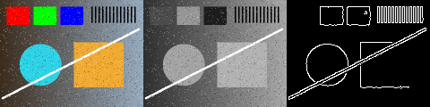
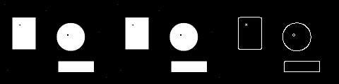

# 이미지·영상 처리 함수 통합 실행 결과 보고서

> **프로젝트:** Day 13 OpenCV 응용 실습 07 — process_image / process_frame 연결  
> **문서 유형:** 기술 검증 / 함수 통합 실행 결과 보고
> **작성일:** 2026-11-04  
> **판정:** **기능 요구사항 충족(PASS) / README 정답 실행 예 4줄 일치, 재실행 PNG 픽셀 동일. Edge 품질은 미평가**  
> **평가 대상:** `07_project.py`(TODO A07·A08), `outputs/p07_*` PNG 12개, `outputs/p07_video.avi`, `outputs/result_summary.csv`

---

## 1. Executive Summary

본 실습의 목적은 **이미지와 영상 Frame에 같은 처리 함수를 연결**하고, 저장 결과와 **재실행 결과가 같은지** 확인하는 절차를 익히는 것이다. 이를 위해 TODO A07에서 Gray → 160×120 Resize → 3×3 Gaussian → Canny 80/160을 하는 `process_image()`를 완성하고, TODO A08에서 영상 Frame에도 같은 함수를 재사용하는 `process_frame()`을 완성하였다.

**실제 실행 결과 기준**, 이미지 처리표는 **9행**(이미지 3장 × gray/small/edge)이고 PNG 9개 모두 **저장·재읽기 일치(True)**였다. 영상은 **48 Frame 처리·재읽기 48**, **160×120, 12.0 FPS**였다. 실습 08로 같은 설정을 다시 실행해 p07_ PNG 12개의 픽셀이 모두 같았고, 실행마다 달라진 값은 process_s뿐이었다.

**README 질문 요약 (2.3절 상세):**
- **입력·출력 경로를 나눈 이유:** 원본이 결과로 덮어쓰여지지 않게 하여 재실행이 항상 같은 입력에서 시작하게 하기 위해서다.
- **모든 Frame decode와 매 N번째 처리의 차이:** N=3이어도 48 Frame을 모두 decode하고 처리·저장만 16 Frame으로 줄어 N배 가속이 아니다.
- **원본 FPS로 16 Frame 저장 시 재생시간:** 16 ÷ 12 ≈ 1.33초로 짧아지므로 FPS를 4로 낮춰 4초를 유지했다.
- **같은 seed와 라벨 보존:** seed는 같은 변형의 재현만 보장하고, 반전·밝기 변형이 라벨 의미를 바꾸는지는 별도로 확인해야 한다.

**최종 판단:** 처리 함수 통합과 재실행 재현성의 실습 완료 조건을 충족했다(PASS). 단, 160×120·Canny 80/160은 고정 파라미터이고 정답 경계가 없어 **Edge 품질은 평가하지 않았다**. 시간 값은 단일 실행 참고값이다.

## 2. 목적 및 검증 범위

### 2.1 검증 목적

- 이미지 처리 규칙을 함수 하나(`process_image`)로 묶고, 영상 Frame에도 같은 함수를 재사용하는지 확인한다.
- 처리 결과를 저장한 뒤 다시 읽어 저장 손실·누락이 없는지 확인한다.
- 같은 설정으로 다시 실행했을 때 결과가 같은지(재현성) 확인한다.

### 2.2 검증 범위

| 구분 | 포함 | 제외 |
|:--|:--|:--|
| 입력 | `data/` scene.png·noisy.png·objects.png(240×320×3), sample.avi(48 Frame) | 다른 해상도·실사 이미지 |
| 처리 | Gray → Resize(160×120) → Gaussian(3×3) → Canny(80/160) | 파라미터 탐색 |
| 검증 | 출력 크기·dtype, PNG 저장·재읽기 일치, 영상 Frame 수·크기·FPS, 재실행 픽셀 비교 | Edge 정확도(정답 경계 없음) |
| 기준값 | README 실습 07 정답 실행 예(참고값) |  |

**TODO 정답:**
- A07 `gray = cv2.cvtColor(image, cv2.COLOR_BGR2GRAY)` → `small = cv2.resize(gray, (160, 120))` → `blur = cv2.GaussianBlur(small, (3, 3), 0)` → `edge = cv2.Canny(blur, 80, 160)`
- A08 `_, _, edge = process_image(frame)` → `cv2.cvtColor(edge, cv2.COLOR_GRAY2BGR)`

원본 A07의 `image[:, :, 0]`은 B 채널만 꺼낸 것이라 Gray가 아니며, 원본 A08은 Edge가 아닌 원본 Frame을 저장했다. 두 함수 모두 파일을 새로 열지 않는다. TODO 외 코드는 원본을 유지하고 세미콜론 문장만 주석을 위해 줄을 나눴다(로직 불변).

### 2.3 README 질문 답변

#### Q1. 입력과 출력 경로를 나눈 이유

원본 입력이 생성 결과로 덮어쓰여지는 것을 막고, 다시 실행할 때 항상 같은 입력에서 시작하기 위해서다. `outputs/`에는 지우고 다시 만들어도 되는 산출물만 들어가므로 제출·비교·정리 범위가 분명하다. 처리 결과가 다시 입력으로 섞여 결과가 누적 변형되는 실수도 막는다. 재실행을 하면 픽셀이 같은 것도 `data/`의 입력이 그대로 보존되기 때문이다.

#### Q2. 모든 Frame decode와 매 N번째 Frame 처리의 차이

decode는 압축된 영상에서 Frame을 꺼내는 단계이고, 처리는 꺼낸 Frame에 process_frame()을 적용해 저장하는 단계다. 실습 07은 cap.read()로 읽은 Frame을 모두 처리하므로 decode 48 = 처리·저장 48이다(실측: Frame 처리/재읽기 48 48). 매 N번째만 처리하도록 바꿔도 cap.read()는 Frame을 건너뛰지 못해 decode는 그대로 48번이고, 줄어드는 것은 process_frame()·writer.write() 횟수(N=3이면 16번, 계산값)뿐이다. 따라서 decode 비용이 남아 전체 시간이 N배 줄지는 않는다. 실습 07에서는 N을 바꿔 실행하지 않았으므로 시간 차이는 측정하지 않았다.

#### Q3. 원본 FPS로 16frame만 저장했다면 왜 재생시간이 달라지는가

재생시간은 저장 Frame 수 ÷ FPS로 정해진다. 실습 07은 48 Frame을 원본 FPS 12.0으로 저장해 48 ÷ 12 = 4초다(실측: 48 Frame, 12.0 FPS). 같은 Writer 설정(fps=fps, 12.0)으로 16 Frame만 저장하면 16 ÷ 12 ≈ 1.33초가 되어 같은 장면이 3배 빠르게 지나간다(계산값). 4초를 유지하려면 FPS를 12 ÷ 3 = 4로 낮춰야 한다. 실습 07 코드 주석의 "모든 frame을 저장하므로 원본 FPS 그대로 사용"이 바로 이 조건이다.

#### Q4. 같은 seed가 라벨 보존을 보장하지 않는 이유

seed는 무작위 선택을 고정해 같은 결과를 다시 만들게(재현성) 할 뿐, 그 결과가 라벨 의미를 유지하는지는 판단하지 않는다. 실습 07에는 seed가 없지만 같은 구분을 보여 준다. 실습 07의 처리는 무작위가 없어 재실행하면 PNG 12개 픽셀이 항상 같다(실측). 그러나 같은 결과가 반복된다고 정보가 보존되는 것은 아니다. Gray 변환에서 색 정보가, 160×120 축소에서 세부가, Canny에서 경계 외 밝기 정보가 사라진다. 예를 들어 "빨간 물체/파란 물체"처럼 색이 라벨인 데이터라면 Edge 결과만으로는 라벨을 구분할 수 없다. 이와 같이 seed를 고정한 좌우 반전·밝기 변형도 매번 같게 재현될 뿐, 방향·밝기가 의미인 라벨은 바꿀 수 있다. 라벨 보존은 데이터별로 허용 변형을 정하고 결과를 확인해야 보장된다.

## 3. 처리 결과 상세

### 3.1 처리 흐름

| 순서 | 처리 | 적용 설정 | 기대 기능 / 효과 |
|:--:|:--|:--|:--|
| 1 | 이미지 읽기 | scene·noisy·objects.png (240×320×3) | 호출한 쪽에서 읽기 |
| 2 | Gray | `BGR2GRAY` (TODO A07) | 밝기 1채널 |
| 3 | Resize | (160, 120) (TODO A07) | 크기 고정 |
| 4 | Gaussian | (3,3), sigma 0 (TODO A07) | 잡음 완화 |
| 5 | Canny | 80/160 (TODO A07) | 경계 추출 |
| 6 | 이미지 저장·재읽기 | `p07_*_{gray,small,edge}.png`, `*_compare.png` | png_equal 확인 |
| 7 | 영상 Frame 처리 | `_, _, edge = process_image(frame)` → `GRAY2BGR` (TODO A08) | 이미지와 같은 규칙 |
| 8 | 영상 저장·재읽기 | MJPG, 12 FPS, `p07_video.avi` | Frame 수·크기·FPS 확인 |
| 9 | 요약 기록 | `result_summary.csv` | 단계별 크기·dtype·저장 여부 |

### 3.2 이미지별 단계 결과 (`result_summary.csv`)

| 원본 | gray | small | edge | saved · png_equal | edge 픽셀 수(보조 측정) | process_s |
|:--|:--|:--|:--|:--:|--:|--:|
| scene.png | 320×240 uint8 | 160×120 uint8 | 160×120 uint8 | 3단계 모두 True | 1,445 | 0.00361 |
| noisy.png | 320×240 uint8 | 160×120 uint8 | 160×120 uint8 | 3단계 모두 True | 1,424 | 0.00026 |
| objects.png | 320×240 uint8 | 160×120 uint8 | 160×120 uint8 | 3단계 모두 True | 444 | 0.00038 |

Gaussian 3×3 단계가 있어 noisy.png의 Edge 수가 scene.png와 비슷한 수준으로 억제되었다(기본필수 07의 Blur 없는 결과와 다른 점). process_s는 이미지별 단일 측정값이며, 첫 호출인 scene이 가장 길다.

### 3.3 비교 그림으로 본 결과 비교 (`outputs/p07_*_compare.png`)

각 비교 그림은 왼쪽부터 **원본 축소(160×120 컬러) | small(Gray 160×120) | edge(Canny 80/160)** 를 가로로 붙인 것이다(코드의 `cv2.hconcat`, 결과 크기 120×480×3). 아래 설명 중 픽셀 수·비율·표준편차는 저장된 PNG에서 센 보조 측정값이고, 나머지는 그림을 보고 관찰한 내용이다.

#### scene.png


- 빨강·초록·파랑 블록, 원, 사각형, 대각선, 줄무늬가 있고 배경은 좌→우로 밝아지는 그라데이션이다.
- small에서 색이 밝기 하나로 바뀐다. 세 색 블록이 서로 다른 회색이 되고, 파랑 블록은 어두운 배경과 밝기 차가 작다.
- edge에서는 원·사각형 윤곽, 대각선(양쪽 테두리 두 줄), 줄무늬가 선명하게 남는다. 천천히 변하는 배경 그라데이션은 경계로 잡히지 않는다.
- Edge 픽셀은 1,445개로 전체 19,200개의 7.53%다.

#### noisy.png



- scene과 같은 장면에 점 잡음이 섞여 있고, small에서도 잡음이 그대로 보인다(small 밝기 표준편차 49.8, scene 49.7).
- 그런데 edge는 scene과 거의 같은 모양이다. Edge 픽셀은 1,424개(7.42%)로 scene보다 21개 적다.
- 3×3 Gaussian과 Canny 이중 임계값(80/160)이 작은 점 잡음을 경계로 남기지 않았다는 뜻이다. 이 실습에서 Blur 단계가 하는 역할이 이 비교에서 가장 분명히 드러난다.

#### objects.png



- 검은 배경 위 흰 사각형·원·가로 막대로 구성된 단순 이진 이미지라 원본과 small의 차이가 거의 없다(small 밝기 표준편차 97.7).
- edge는 세 도형의 윤곽선과 도형 안 작은 검은 점의 테두리만 남는다. Edge 픽셀은 444개(2.31%)로 가장 적다.
- 도형 수가 적고 경계가 뚜렷해서 Edge가 적다. Edge 수가 적다고 처리가 실패한 것은 아니다.

#### 세 이미지 비교 정리

| 원본 | 이미지 특징 | edge에서 보이는 것 | Edge 픽셀(비율) |
|:--|:--|:--|--:|
| scene.png | 색 블록·도형·줄무늬, 그라데이션 배경 | 도형 윤곽, 대각선, 줄무늬 | 1,445 (7.53%) |
| noisy.png | scene + 점 잡음 | scene과 거의 같은 윤곽, 잡음 점은 거의 없음 | 1,424 (7.42%) |
| objects.png | 흰 도형 3개, 검은 배경 | 도형 윤곽과 내부 점 테두리 | 444 (2.31%) |

- **같은 함수, 같은 파라미터:** 세 이미지 모두 같은 `process_image()`를 거쳤고 결과 크기가 160×120으로 같다.
- **잡음 억제:** noisy와 scene의 Edge 차이는 21개(약 1.5%)뿐이다. Gaussian 3×3이 잡음으로 생길 경계를 막았다.
- **사라지는 정보:** 세 그림 모두 small 단계에서 색이, edge 단계에서 면의 밝기가 사라진다. 2.3절 Q4의 "결과가 같아도 정보가 보존되는 것은 아니다"를 이 그림으로 확인할 수 있다.
- **한계:** 정답 경계가 없어 어느 Edge가 "맞는지"는 판정하지 않는다. 위 비교는 그림 관찰과 픽셀 수 비교다.

### 3.4 영상 처리 결과

| 항목 | 실제 실행 결과 |
|:--|:--|
| 처리 Frame / 재읽기 Frame | 48 / 48 |
| 재읽기 크기 | 160×120, 3채널 |
| 재읽기 FPS | 12.0 |
| 파일 크기 | 243,686 byte (MJPG AVI, 코덱·환경 영향 참고값) |

### 3.5 표준 출력 (`outputs/logs/outputs_07_project.log`)

```text
이미지 처리표: 9 행 / 원본3장
Frame 처리/재읽기: 48 48
재읽기 크기/FPS: 160 120 12.0
PNG 저장·재읽기 모두 일치: True
```

README 실습 07 정답 실행 예 4줄과 같다.

## 4. 품질 검증 및 합격 기준

### 4.1 합격 기준 대비 결과

| 항목 | 합격 기준(README) | 실제 실행 결과 | 판정 |
|:--|:--|--:|:--:|
| 이미지 처리표 | 9 행 / 원본 3장 | **9행 / 원본 3장** | PASS |
| PNG 저장·재읽기 일치 | True | **True (9/9)** | PASS |
| Frame 처리 / 재읽기 | 48 48 | **48 / 48** | PASS |
| 재읽기 크기 / FPS | 160 120 12.0 | **160×120 / 12.0** | PASS |
| 결과 파일 구성 | 단계별 9 + 비교 3 + 영상 1 + CSV | **9 + 3 + 1 + 1** | PASS |
| 재실행 재현성(실습 08) | 픽셀·설정·파일 수 동일 | **PNG 12개 픽셀 동일** | PASS |
| process_s | 기준 없음(환경 의존) | **0.00026 ~ 0.00361 s** | 측정값 |
| Edge 품질 | 기준 없음 | 정답 경계 미제공 | 미평가 |

> **주의:** process_s는 실행마다 달라지는 값이며 순위를 정하지 않는다. 02_응용에는 `expected/`가 없어 README 정답 실행 예를 참고값으로 대조했다.

### 4.2 기능 검증 (Acceptance Test)

| TC ID | 검증 내용 | 관찰 근거 | 결과 |
|:--|:--|:--|:--:|
| TC-01 | 표준 출력 4줄 | `outputs/logs/outputs_07_project.log` = README 정답 예 | PASS |
| TC-02 | 단계별 결과 | `result_summary.csv` 9행, 모두 saved=True·png_equal=True | PASS |
| TC-03 | 출력 크기·자료형 | gray 320×240, small·edge 160×120, 모두 uint8 | PASS |
| TC-04 | 영상 재읽기 | 48 Frame, 160×120, 12.0 FPS | PASS |
| TC-05 | 재실행 재현성 | p07_ PNG 12개 픽셀 배열 동일 | PASS |
| TC-06 | Edge 품질 | 정답 경계 미제공 | 미평가 |

## 5. 리스크 및 개선 과제

| 우선순위 | 이슈 / 잠재 영향 | 개선 과제 | 검증 산출물 |
|:--:|:--|:--|:--|
| P0 | 수업 venv에서 같은 결과가 나오는지 미확인 | `python 07_project.py` 2회 실행(짝 확인) | 출력 4줄·CSV 9행 동일 |
| P1 | 160×120·Canny 80/160 고정값이 모든 입력에 맞지 않음 | 크기·커널·임계값을 설정 dict로 저장하고 이미지별 Edge 품질 확인 | 설정 JSON, 이미지별 비교 |
| P1 | MJPG 손실 압축이라 영상 픽셀은 PNG처럼 정확히 같지 않을 수 있음 | 영상은 Frame 수·크기·FPS로 검증, 픽셀 비교가 필요하면 무손실 저장 | 검증 기준표 |
| P2 | 재실행 직후 네트워크 폴더에서 md5 비교가 한 번 어긋남(픽셀 비교는 일치, 동기화 지연 추정) | 로컬 디스크에서 재확인 | 로컬 md5 비교 로그 |
| P2 | process_s 단일 측정이라 순위 판단 불가 | 이미지별 반복 측정 | process_s 중앙값 표 |

## 6. 다음 단계: 현업 적용 승인 전 검증 계획

이번 결과는 합성 이미지 3장과 짧은 영상 1개에서 확인한 교육용 결과다. 같은 처리 함수를 실제 데이터 전처리에 쓰려면 다음을 순서대로 확인한다.

| 단계 | 검증 항목 | 방법 | 통과 조건 |
|:--:|:--|:--|:--|
| 1 | 환경 재현 | 수업 venv·다른 PC에서 2회 실행 | 출력 4줄, CSV 9행, PNG 픽셀 동일 |
| 2 | 파라미터 분리 | 크기·커널·Canny 임계값을 설정 파일로 분리하고 결과와 함께 저장 | 설정 파일만으로 같은 결과 재생성 |
| 3 | 입력 다양성 | 해상도·밝기·잡음이 다른 실제 이미지에 적용 | 이미지별 Edge 비교 그림 육안 검토 |
| 4 | Edge 품질 | 정답 경계(일부 수작업 라벨)와 비교 | 기준 지표(예: 경계 일치율)를 사전에 정해 기록 |
| 5 | 영상 검증 기준 | MJPG 손실을 고려해 Frame 수·크기·FPS 기준 확정, 필요 시 무손실 저장 | 검증 기준표 확정 |
| 6 | 처리 시간 | 반복 측정 후 중앙값 기록 | 환경 정보와 함께 참고값으로 보고 |

## 7. 최종 판단

- **기능 검증:** TODO A07·A08을 완성해 이미지와 영상에 같은 처리 함수를 연결했고, 표준 출력과 결과 파일 구성이 README와 같았다.
- **재현성:** 실습 08 재실행에서 PNG 12개의 픽셀과 파일 구성이 같았고, 시간만 달랐다.
- **품질 검증:** 정답 경계가 없어 Edge 품질은 평가하지 않았다.
- **판단:** 본 실습은 **완료(PASS)**로 분류한다. 다른 입력에 적용하기 전에 6장의 검증 계획 중 파라미터 분리와 입력 다양성 확인을 먼저 수행한다.

---

## 부록 A. 근거 파일 및 검증 이력

### A.1 근거 파일

| 파일 | 역할 |
|:--|:--|
| `07_project.py` | TODO A07·A08 완성 + 전체 주석 |
| `data/` | scene.png, noisy.png, objects.png, sample.avi 입력 |
| `outputs/p07_{scene,noisy,objects}_{gray,small,edge}.png` | **실제 실행 단계별 결과** 9개 |
| `outputs/p07_{scene,noisy,objects}_compare.png` | **실제 실행 비교 그림** 3개 |
| `outputs/p07_video.avi` | **실제 실행 Edge 영상** |
| `outputs/result_summary.csv` | **실제 실행 단계별 요약** |
| `outputs/logs/outputs_07_project.log` | **실제 실행 표준 출력** |
| `../README.md` | 실습 07·08 정답 실행 예와 질문(참고값) |

### A.2 검증 이력

| 일자 | 내용 | 결과 |
|:--|:--|:--|
| 2026-11-04 | `07_project.py` 1회 실행, 표준 출력·CSV를 README 정답 예와 대조 | 4줄 일치, CSV 9행 모두 True |
| 2026-11-04 | 같은 설정으로 2회 더 실행(실습 08), PNG 픽셀 배열·CSV 비교 | PNG 12개 픽셀 동일, process_s만 다름 |
| 2026-11-04 | 저장된 Edge PNG의 0이 아닌 픽셀 수와 AVI 재읽기(Frame 수·크기·FPS) 보조 측정 | 1,445 / 1,424 / 444, 48 Frame·160×120·12.0 |
| 2026-11-04 | 보고서를 새 목차(1~7장 + 부록 A)로 재구성 | 수치 변경 없음 |

- **재현 명령:** `python 07_project.py`
- **보고 원칙:** **측정된 사실**, **그 사실에서 계산한 값**, **아직 검증되지 않은 가정**을 구분하여 작성했다.

*교육용 실습 결과 보고서 — 2026-11-04 실제 실행 산출물(`outputs/`)과 README 실습 07·08을 근거로 작성했으며 운영 승인 문서가 아니다.*
