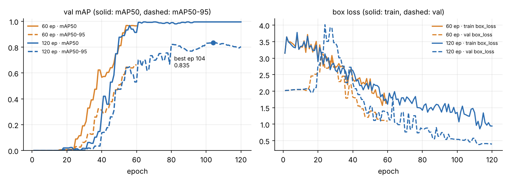

# 탐지·추적 실험 보고서

> **보고서 ID:** D15-C07-DET-PC  
> **작성 기준일:** 2026-11-06  
> **근거:** PC 실행 결과 폴더 3개 — `outputs/`(2 epoch smoke), `outputs_60/`(60 epoch), `outputs_120/`(120 epoch). 각 폴더의 predictions·image_counts·tracks·frames CSV, summary.json, tracked.avi, 모델 파일, images/ 12장. 학습곡선 그림 `reports/learning_curve.png`  
> **판정:** 파이프라인 동작 **PASS**(3회 모두 12장·30프레임 처리). 성능은 2 epoch **판단 불가**(검출 0), 60 epoch **부분 통과**(TP 26/30, 중복 FP 6, ID switch 10), 120 epoch **val 기준 통과**(TP 30/30, FP 0, ID 3개·switch 0)

## 0. 결론 요약

### 0.1 문제의식 (1차 실행)

1차 실행(`outputs/`)은 이미지 12장과 프레임 30장을 모두 처리했지만 **검출이 0건, track도 0행**이었다. 모델 파일을 열어 보니 `data/demo.pt`가 2 epoch만 학습한 smoke 모델(val mAP 0)이었다. 그래서 다음과 같이 가설을 세웠다. 탐지·추적 코드의 문제라기보다 **학습이 거의 되지 않은 모델이 물체를 전혀 검출하지 못했을 가능성**이 크다. 이 가설을 확인하려고 epoch만 60과 120으로 늘려 같은 조건으로 다시 실행했다.

### 0.2 세 실행 비교 (핵심 지표)

| 지표 | 2 epoch (`outputs`) | 60 epoch (`outputs_60`) | 120 epoch (`outputs_120`) |
|:--|--:|--:|--:|
| val mAP50 (모델에 저장된 값) | 0.000 | 0.965 | **0.995** |
| val mAP50-95 | 0.000 | 0.662 | **0.835** |
| mAP50-95 / mAP50 | — | 0.69 | **0.84** |
| 이미지 검출 수 (conf 0.25) | 0 | 32 | 30 |
| TP / FP / FN (정답 30개) | 0 / 0 / 30 | 26 / 6 / 4 | **30 / 0 / 0** |
| Precision / Recall (conf 0.25) | — / 0.00 | 0.81 / 0.87 | **1.00 / 1.00** |
| TP 박스 IoU 평균 | — | 0.831 | **0.913** |
| track 행 (정답 90행) | 0 | 100 | **90** |
| Track ID 수 (정답 물체 3개) | 0 | 6 | **3** |
| ID switch | 측정 불가 | 10 | **0** |

**최종 결론.** epoch를 늘리자 검출 0이 사라졌고, 1차 실행의 원인이 모델 학습 부족이라는 가설을 지지한다. 60 epoch에서는 mAP50이 0.965까지 올랐다. 하지만 mAP50-95가 0.662로 낮아, 객체를 탐지하더라도 **Bounding Box의 위치 정밀도가 충분하지 않을 가능성**이 있다. 실제로 이 단계에서는 중복 박스 6개, 놓친 square 3개, ID switch 10회가 남았다. 120 epoch에서는 val 12장과 영상 30프레임의 오류가 모두 사라졌다. 다만 이 val은 epoch 선택에 쓴 데이터이고 표본도 작다. 따라서 test(보관)나 새 영상에서 **객체 위치 예측 성능과 클래스별 탐지 성능을 추가로 분석할 필요**가 있다.

---

## 1. 모델 출처/파일 해시

| 항목 | 2 epoch | 60 epoch | 120 epoch |
|:--|:--|:--|:--|
| 파일 | `outputs/model.pt` | `outputs_60/model_60.pt` | `outputs_120/model_120.pt` |
| SHA-256 | `a1d2ca2fe97fb8e1…0d4` | `c761a067cec55048…056` | `d84255adec3dfb64…ba` |
| summary.json 해시와 일치 | O | O | O |
| 크기 | 5,330,757 B | 5,338,181 B | 5,345,861 B |
| 시작 구조 | `yolo26n.yaml` (무작위 초기화, `pretrained=False`) | 같음 | 같음 |
| 학습 설정 | epochs 2, imgsz 160, batch 4, SGD lr0 0.01, seed 42, cpu | epochs **60**, 나머지 같음 | epochs **120**, 나머지 같음 |
| 학습 run 이름 | `smoke` (응용 04 학습 코드) | `smoke` | `smoke` |
| 저장된 epoch | 2 epoch 중 best | best = epoch 59 (60과 지표 동일) | best = epoch **104** (last 120은 mAP50-95 0.804) |
| 학습 시간 (기록값, 참고) | 1.7 s | 34.1 s | 68.6 s |
| Ultralytics (저장 시) | 8.4.202 | 8.4.203 | 8.4.203 |

전체 SHA-256은 다음과 같다.
- 2 epoch: `a1d2ca2fe97fb8e11a3c919a9a542bbe5b6f501b33d29c9d2cb6d39e901d0ed4`
- 60 epoch: `c761a067cec550483e49d907d6a196bd1805c9385738489236f7e5d0e6d58056`
- 120 epoch: `d84255adec3dfb64f4d3d77c21fc08ca42d39258d27c4ea0f99b9d1cd97bd2ba`

### 1.1 학습 기록 (모델 파일의 `train_results`)

| epoch | 60 epoch run: mAP50 / mAP50-95 | 120 epoch run: mAP50 / mAP50-95 |
|--:|:--|:--|
| 1 | 0.000 / 0.000 | 0.000 / 0.000 |
| 10 | 0.000 / 0.000 | 0.000 / 0.000 |
| 20 | 0.008 / 0.002 | 0.020 / 0.005 |
| 30 | 0.191 / 0.063 | 0.017 / 0.003 |
| 40 | 0.567 / 0.309 | 0.281 / 0.137 |
| 50 | 0.812 / 0.510 | 0.877 / 0.474 |
| 60 | **0.965 / 0.662** | 0.914 / 0.531 |
| 80 | — | 0.989 / 0.821 |
| 100 | — | 0.995 / 0.831 |
| 104 (best) | — | **0.995 / 0.835** |
| 120 | — | 0.995 / 0.804 |

그림: 왼쪽은 val mAP50(실선)과 mAP50-95(점선), 오른쪽은 train box_loss(실선)와 val box_loss(점선)다. 주황은 60 epoch run, 파랑은 120 epoch run이다. 점은 120 epoch run의 best epoch 104(mAP50-95 0.835)다. 모델 파일의 `train_results`로 그렸다.

- 두 run 모두 20 epoch 전후까지 mAP가 거의 0이다. 2 epoch smoke 모델이 아무것도 검출하지 못한 것과 같은 흐름이다.
- mAP50은 60-80 epoch에서 0.96-0.99에 이르렀다. mAP50-95는 그 뒤로도 계속 올랐다.
- val box_loss는 처음 20 epoch 동안 2.0 근처에 머물다가, mAP가 오르기 시작하는 20-30 epoch에 튀는 모습을 보인다. 그 뒤로는 내려가 120 epoch run에서 0.5 근처까지 떨어졌다.  

## 2. 코드·Python·Ultralytics·PyTorch·OpenCV 버전

| 항목 | 값 |
|:--|:--|
| 코드 | `main.py`·`vision.py`. 세 실행 모두 같은 코드를 쓰고 모델 파일만 바꿈 |
| Ultralytics (모델 저장 시) | 8.4.202 (2 epoch), 8.4.203 (60·120 epoch) |
| Python · PyTorch · OpenCV (추론 실행 시) | Python 3.13.16, Ultralytics 8.4.203, torch 2.14.0+cu130, OpenCV 5.0.0 |

## 3. split, imgsz, conf, tracker, device

| 항목 | 값 (세 실행 공통) | 근거 |
|:--|:--|:--|
| split | val (`data/images/val`) · test 미사용 | summary.json `split`, `test_used: false` |
| imgsz | 160 | 인자를 주지 않으면 checkpoint의 학습 imgsz 160이 쓰인다 |
| conf | 0.25 | `detect_images(..., conf=.25)` 기본값 |
| tracker | `bytetrack.yaml`, `persist=False` | `track_video` 기본 인자, README C08 |
| device | CPU | (device='cpu')  |
| 스레드 | `torch.set_num_threads(1)` | main.py |
| 바꾼 것 | **모델 파일(학습 epoch)만** | 3절 고정 조건 |

## 4. 데이터의 클래스/비율/원본 분할

| split | 이미지 | 객체 | square | circle | triangle | negative |
|:--|--:|--:|--:|--:|--:|--:|
| train | 36 | 90 | 30 | 30 | 30 | 6 |
| **val (이번 입력)** | **12** | **30** | 10 | 10 | 10 | 2 (`standard_val_005`, `standard_val_011`) |
| test | 12 | 30 | 10 | 10 | 10 | 2 |

- 원본 분할은 `data/manifest.csv`의 split·group_id를 따른다.
- 영상 `data/demo.avi`는 160×128, 10 FPS, 30프레임이다. `track_ground_truth.csv`는 90행(30프레임 × 물체 3개, gt_id 1=square, 2=circle, 3=triangle)이다.
- 학습은 train으로 했고, val은 학습 중 best epoch 선택에도 쓰였다.

## 5. 처리 이미지 수 / 원본·출력 Frame 수 / FPS / 해상도

| 항목 | 입력 | 2 epoch | 60 epoch | 120 epoch |
|:--|:--|:--|:--|:--|
| 처리 이미지 (`image_counts.csv` 행 / PNG 수) | 12 | 12 / 12 | 12 / 12 | 12 / 12 |
| 프레임 (`frames.csv` 행 / tracked.avi) | 30 | 30 / 30 | 30 / 30 | 30 / 30 |
| FPS | 10.0 | 10.0 | 10.0 | 10.0 |
| 해상도 | 160×128 | 160×128 | 160×128 | 160×128 |

세 실행 모두 입력 수와 출력 수가 같다. 검출이 0인 이미지도 처리 수에 남았다. 2 epoch 출력 PNG는 그릴 박스가 없어 입력과 픽셀이 모두 같다.

## 6. 검출 없는 이미지 수, FP·FN을 확인한 방법

**확인 방법.** `predictions.csv`를 `data/labels/val/*.txt`(픽셀 xyxy로 변환)와 비교한다. 같은 이미지·같은 클래스·IoU ≥ 0.5로, confidence가 높은 예측부터 일대일로 짝짓는다. 짝지어진 예측은 TP다. 남은 예측은 겹치는 정답에 따라 중복(Duplicate)·클래스 혼동·느슨한 박스·배경 FP로 나눈다. 짝이 없는 정답은 FN이다.

### 6.1 이미지 단위

| 항목 | 2 epoch | 60 epoch | 120 epoch |
|:--|--:|--:|--:|
| 검출 없는 이미지 | 12 / 12 | 2 / 12 (negative 2장) | 2 / 12 (negative 2장) |
| negative 2장의 검출 (배경 FP) | 0 | 0 | 0 |
| 이미지별 검출 수 | 12장 모두 0개 | 0개~4개로 고르지 않음 (아래 표) | 물체 있는 10장은 각 3개, negative 2장은 0개 |
| confidence 평균 (최소~최대) | — | 0.742 (0.256~0.995) | 0.854 (0.577~0.971) |

**이미지별 검출 수와 정답 대조 (conf 0.25).** 이미지마다 정답은 3개(square·circle·triangle 각 1개)이고, negative 2장(005·011)은 0개다. 검출 수가 정답 수와 같아도 정답을 모두 맞혔다는 뜻은 아니므로, TP·FP·FN을 함께 적는다.

| 이미지 | 정답 | 2 epoch 검출 | 60 epoch 검출 | 60 epoch TP / FP / FN | 60 epoch 내용 | 120 epoch 검출 | 120 epoch TP / FP / FN |
|:--|--:|--:|--:|:--|:--|--:|:--|
| standard_val_000 | 3 | 0 | 2 | 2 / 0 / 1 | triangle 놓침 | 3 | 3 / 0 / 0 |
| standard_val_001 | 3 | 0 | 3 | 2 / 1 / 1 | square 놓침 + triangle 중복 → 개수만 3으로 맞음 | 3 | 3 / 0 / 0 |
| standard_val_002 | 3 | 0 | 3 | 2 / 1 / 1 | square 놓침 + circle 중복 → 개수만 3으로 맞음 | 3 | 3 / 0 / 0 |
| standard_val_003 | 3 | 0 | 4 | 3 / 1 / 0 | triangle 중복 | 3 | 3 / 0 / 0 |
| standard_val_004 | 3 | 0 | 4 | 3 / 1 / 0 | triangle 중복 | 3 | 3 / 0 / 0 |
| standard_val_005 (negative) | 0 | 0 | 0 | 0 / 0 / 0 | 정상 (배경 FP 없음) | 0 | 0 / 0 / 0 |
| standard_val_006 | 3 | 0 | 4 | 3 / 1 / 0 | circle 중복 | 3 | 3 / 0 / 0 |
| standard_val_007 | 3 | 0 | 2 | 2 / 0 / 1 | square 놓침 | 3 | 3 / 0 / 0 |
| standard_val_008 | 3 | 0 | 4 | 3 / 1 / 0 | triangle 중복 | 3 | 3 / 0 / 0 |
| standard_val_009 | 3 | 0 | 3 | 3 / 0 / 0 | 정상 | 3 | 3 / 0 / 0 |
| standard_val_010 | 3 | 0 | 3 | 3 / 0 / 0 | 정상 | 3 | 3 / 0 / 0 |
| standard_val_011 (negative) | 0 | 0 | 0 | 0 / 0 / 0 | 정상 (배경 FP 없음) | 0 | 0 / 0 / 0 |
| **합계** | **30** | **0** | **32** | **26 / 6 / 4** | 완전히 맞은 이미지 2장(009·010) + negative 2장 | **30** | **30 / 0 / 0** |

60 epoch는 박스 수가 정답보다 많은 이미지(4개) 4장, 적은 이미지(2개) 2장, 개수는 맞지만 하나를 놓치고 하나를 중복으로 잡은 이미지 2장이 섞여 있다. 120 epoch는 물체가 있는 10장에서 모두 정확히 3개를 찾았고, 3개 모두 정답과 짝지어졌다(TP). negative 2장에서는 아무것도 검출하지 않았다.

### 6.2 클래스별 Precision·Recall·TP IoU (conf 0.25)

| 클래스 | 60 epoch: 예측 / TP / P / R | 60 epoch TP IoU 평균 (최소) | 120 epoch: 예측 / TP / P / R | 120 epoch TP IoU 평균 (최소) |
|:--|:--|:--|:--|:--|
| square | 7 / 7 / 1.00 / **0.70** | 0.860 (0.764) | 10 / 10 / 1.00 / 1.00 | 0.918 (0.874) |
| circle | 12 / 10 / 0.83 / 1.00 | 0.823 (0.741) | 10 / 10 / 1.00 / 1.00 | 0.885 (0.836) |
| triangle | 13 / 9 / **0.69** / 0.90 | 0.818 (0.731) | 10 / 10 / 1.00 / 1.00 | 0.935 (0.903) |

2 epoch는 예측이 0개라 세 클래스 모두 Recall 0이고 Precision은 계산할 수 없다.

### 6.3 60 epoch에 남은 오류 목록

| 종류 | 이미지 | 클래스 | confidence | 정답과 IoU |
|:--|:--|:--|--:|--:|
| 중복 FP | standard_val_001 | triangle | 0.655 | 0.678 |
| 중복 FP | standard_val_002 | circle | **0.910** | 0.822 |
| 중복 FP | standard_val_003 | triangle | 0.399 | 0.754 |
| 중복 FP | standard_val_004 | triangle | 0.256 | 0.827 |
| 중복 FP | standard_val_006 | circle | 0.323 | 0.529 |
| 중복 FP | standard_val_008 | triangle | **0.861** | 0.814 |
| FN | standard_val_000 | triangle | — | — |
| FN | standard_val_001 · 002 · 007 | square | — | — |

FP 6개는 모두 **이미 맞은 물체를 한 번 더 찍은 중복**이다. 배경 오검출이나 클래스 혼동은 없었다. 중복 박스 가운데 2개는 confidence가 0.8600.91로 높아, conf를 올려서는 걸러지지 않는다. FN 4개 가운데 3개가 square였고, 그래서 square의 Recall이 0.70으로 가장 낮다.

## 7. Track ID 수와 ID switch를 구분한 근거

**구분 방법.**
- **Track ID 수:** `tracks.csv`의 서로 다른 `track_id` 개수다. 중복 박스나 끊겼다 다시 생긴 track도 따로 센다.
- **ID switch:** 프레임마다 track을 `track_ground_truth.csv`의 `gt_id`와 같은 클래스·IoU ≥ 0.5로 짝짓는다. 그런 다음 같은 `gt_id`에 붙은 track_id가 바로 전에 짝지어진 프레임과 달라진 횟수를 센다.

| 지표 | 2 epoch | 60 epoch | 120 epoch |
|:--|--:|--:|--:|
| track 행 (정답 90) | 0 | 100 | 90 |
| 정답과 짝지어진 행 / 놓친 정답 | 0 / 90 | 86 / 4 | **90 / 0** |
| 짝 없는 track 행 (중복·오검출) | 0 | 14 | 0 |
| Track ID 수 (정답 3) | 0 | 6 | **3** |
| 정답 물체별로 붙은 ID | — | square {3, 7} · circle {1, 5} · triangle {2, 9} | square {2} · circle {1} · triangle {3} |
| ID switch | 측정 불가 | **10** | **0** |
| 프레임별 검출 수 분포 | 0개 30프레임 | 2개 4 · 3개 13 · 4개 12 · 5개 1 | 3개 30프레임 |

**60 epoch의 track 구성 (ID: 클래스, 프레임 범위, 행 수).** 1: circle 0-22, 23행 · 2: triangle 0-29, 30행 · 3: square 0-29, 24행 · 5: circle 5-29, 12행 · 7: square 7-11, 4행 · 9: triangle 19-29, 7행.

60 epoch에서는 ID가 6개로 정답 물체 수의 두 배다. 정답 물체마다 ID가 2개씩 붙었고, 두 ID가 번갈아 정답에 짝지어지면서 switch가 10회 생겼다. 이것은 6.3절의 **중복 박스**와 같은 원인으로 본다. 같은 물체에 박스 두 개가 나오면 tracker가 두 track을 함께 유지한다. 그러다 프레임마다 어느 쪽이 정답과 더 잘 겹치는지가 바뀐다(가설). 120 epoch에서는 물체마다 ID 하나가 30프레임 내내 유지됐다. 따라서 **ID 수가 3이라는 것**과 **switch가 0이라는 것**을 따로 확인했다.

## 8. 오류 2건: 실제 관찰 / 원인 가설 / 다음 확인 순서

### 오류 1. 2 epoch 모델의 전체 검출 0건 (이미지 FN 30, track 0행) — 1차 실행

| 구분 | 내용 |
|:--|:--|
| 실제 관찰 | 2 epoch 모델은 이미지 12장과 프레임 30장 모두 검출 0이었다. 모델에 저장된 val P·R·mAP도 0이다 |
| 원인 가설 | 학습 부족. 1.1절처럼 같은 설정의 60·120 epoch run도 20 epoch 전후까지 mAP가 0이었다 |
| 확인 결과 | **가설 지지.** 모델만 60·120 epoch로 바꾸자 검출 32·30건, track 100·90행이 나왔다. 코드·데이터·conf·tracker는 그대로였다 |
| 남은 확인 | 강사가 준비한 demo.pt로도 같은 결과가 나오는지 확인(미실행) |

### 오류 2. 60 epoch 모델의 중복 박스 6개와 ID switch 10회

| 구분 | 내용 |
|:--|:--|
| 실제 관찰 | 이미지에서 중복 FP 6개(triangle 4, circle 2)와 FN 4개(square 3, triangle 1)가 나왔다. 영상에서는 ID 6개, 짝 없는 track 행 14개, ID switch 10회가 나왔다 |
| 원인 가설 | 60 epoch에서는 mAP50-95가 0.662에 머물러 박스 위치가 아직 덜 정밀하다(TP IoU 평균 0.831). 같은 정답과 IoU 0.53~0.83로 겹치는 두 번째 박스가 남았다. 두 박스끼리의 겹침이 NMS 기준(IoU 0.7)을 넘지 않거나 클래스 점수가 비슷해 둘 다 살아남은 것으로 보인다(검증하지 않은 가설) |
| 확인 결과 | 120 epoch에서 mAP50-95가 0.835, TP IoU 평균이 0.913으로 오르자 중복·FN·ID switch가 모두 0이 됐다 |
| 다음 확인 순서 | ① 60 epoch 모델에서 NMS IoU를 0.5로 낮췄을 때 중복이 줄어드는지 확인 ② square FN 3장(val_001·002·007)을 conf 0.15로 다시 보고, 낮은 점수로라도 박스가 있는지 확인 ③ 120 epoch 모델을 test 12장에 한 번만 적용해 일반화 확인 |

## 9. 원본 보존·같은 조건 재실행 여부

| 항목 | 상태 |
|:--|:--|
| 원본 보존 | 입력 `data/`는 읽기만 했고, 결과는 실행마다 다른 폴더(`outputs`, `outputs_60`, `outputs_120`)에 따로 저장됐다 |
| 모델 보관 | 세 폴더 모두 모델 파일의 SHA-256이 summary.json의 해시와 같다 |
| 같은 조건 비교 | 세 실행 모두 같은 코드·val·영상·conf·tracker를 쓰고 모델만 바꿨다 |
| 같은 모델 재실행 (`restore.py`, C10) | **미실행**. 세 폴더 모두 `restored_images/`가 없다 |
| 같은 설정 재학습 | **미실행**. 60·120 epoch 학습은 각각 한 번씩만 했다 |

## 10. 합성 데이터·미검증 환경·라이선스 등 한계

| 한계 | 내용 |
|:--|:--|
| 선택 편향 | 120 epoch 모델의 best epoch(104)를 같은 val로 골랐다. 따라서 val의 TP 30/30은 일반화 성능보다 낙관적이다. test는 호출하지 않았다 |
| 표본 | val 12장(클래스당 10개)과 영상 30프레임 1개뿐이다. 오류 1개가 recall 0.1을 바꾼다 |
| 데이터 | OpenCV로 만든 합성 도형(160×128, 클래스와 색이 연관됨)이다. 자연 사진이나 안전 관련 서비스의 정확도를 입증하지 않는다 |
| 영상 | 개발 데모이며 최종 test가 아니다. 영상 사이에서 ID가 같다는 주장이나 사람의 정체성 식별을 하지 않는다 |
| 라이선스 | Ultralytics는 AGPL-3.0이다(checkpoint `license` 필드). 배포·서비스에 쓰려면 라이선스 조건을 따로 검토해야 한다 |
