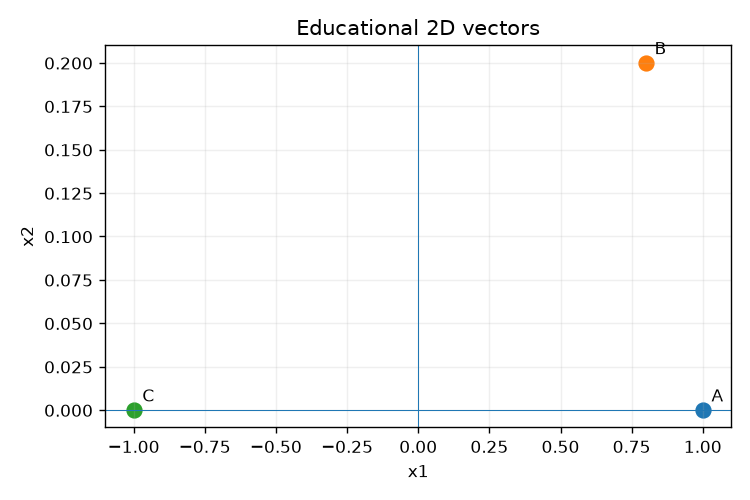
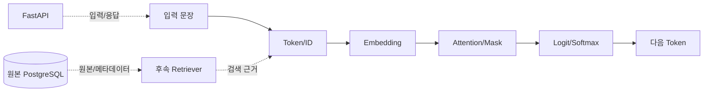

# 실습 8 · 일일프로젝트: 문장 하나가 LLM 출력이 되기까지

> **보고서 ID:** D20-B08-DLY-PRJ  
> **작성 기준일:** 2026-11-13  
> **검증 범위:** `01_basic/08_daily_project/main.py`의 TODO 6개 완성본, `outputs/daily_project.json`, `outputs/one_page_summary.md`

### 작업 1 · Token — 문장 1개를 Token/ID/길이로 분석 (B01)

| 완료 조건 | 판정 | 근거 |
|---|:--:|---|
| 문장 1개 선택 | 충족 | 공통 지식 A "실습 파일은 개인 폴더에 보관합니다." |
| Token으로 분석 | 충족 | 조각 6개 + 특수 Token 2개 |
| ID로 분석 | 충족 | 어휘표(20개) 행 번호로 변환 |
| 길이·Context 제한 확인 | 충족 | 길이 8 / 상한 12, 잘림 없음 |

**남길 결과: Token 표**

| 위치 | 0 | 1 | 2 | 3 | 4 | 5 | 6 | 7 |
|---|---|---|---|---|---|---|---|---|
| Token | [BOS] | 실습 | 파일은 | 개인 | 폴더에 | 보관합니다 | . | [EOS] |
| Token ID | 2 | 10 | 15 | 5 | 16 | 7 | 4 | 3 |
| attention_mask | 1 | 1 | 1 | 1 | 1 | 1 | 1 | 1 |

| 길이 항목 | 값 |
|---|---|
| Token 수 (특수 Token 포함) | 8 (일반 6 + [BOS]/[EOS] 2) |
| Context 상한 (max_length) | 12 (66.67% 사용) |
| 잘림 여부 | 없음 (truncated=False, 원래 길이 8) |

- 해석: Token ID는 어휘표의 행 번호일 뿐 의미 벡터가 아니다.

### 작업 2 · Embedding — 제공 벡터로 유사도 비교 (B02)

| 완료 조건 | 판정 | 근거 |
|---|:--:|---|
| 3개 문장 또는 제공 벡터 사용 | 충족 | 제공된 교육용 2D 벡터 A/B/C |
| 유사도 비교 | 충족 | A 기준 Cosine 2쌍 계산, 가장 비슷한 벡터 B |

**Cosine 표**

| 비교 | 벡터 | Cosine | 방향 해석 |
|---|---|---:|---|
| A–B | [1.0, 0.0] vs [0.8, 0.2] | 0.9701 | 거의 같은 방향 → 가장 비슷함 |
| A–C | [1.0, 0.0] vs [-1.0, 0.0] | -1.0000 | 정반대 방향 |

**간단 그림**

| 그림에서 읽을 점 | 내용 |
|---|---|
| A와 B | 원점에서 거의 같은 방향(오른쪽)에 있다 → Cosine 0.9701 |
| A와 C | 원점을 사이에 두고 정반대에 있다 → Cosine -1.0 |

- 해석: B가 가까운 이유는 교육용 좌표를 그렇게 정했기 때문이다. 문장 의미를 학습한 Embedding이 아니며, Cosine이 높다고 답변이 사실이라는 보장도 없다.

### 작업 3 · Attention — 3×3 가중치와 Mask의 의미 확인 (B03)

| 완료 조건 | 판정 | 근거 |
|---|:--:|---|
| 3×3 가중치 계산 | 충족 | Q=K=V=[[1,0],[0,1],[1,1]] → Score·Weight (3, 3) |
| Mask 의미 확인 | 충족 | Causal Mask가 미래 Key 3칸을 막아 Weight 0 |
| 행 합 확인 | 충족 | 각 Query 행의 합 1.0 |

**Weight Matrix (행 = Query, 열 = Key)**

| Query \ Key | t1 | t2 | t3 | 행 합 |
|---|---:|---:|---:|---:|
| t1 | 1.0000 | 0.0000 | 0.0000 | 1.0 |
| t2 | 0.3302 | 0.6698 | 0.0000 | 1.0 |
| t3 | 0.2483 | 0.2483 | 0.5035 | 1.0 |

**Causal Mask Matrix (True = 미래 위치 차단)**

| Query \ Key | t1 | t2 | t3 | 볼 수 있는 Key 수 |
|---|:--:|:--:|:--:|---:|
| t1 | False | True | True | 1 |
| t2 | False | False | True | 2 |
| t3 | False | False | False | 3 |

- 해석: 학습된 모델의 Attention이 아니다. Weight가 크다고 그 Token이 답변의 원인이라고 말하지 않는다.

### 작업 4 · 출력 흐름 — Logit→Softmax→선택→반복 설명 (B04, B05)

| 완료 조건 | 판정 | 근거 |
|---|:--:|---|
| Logit | 충족 | 후보 3개 점수 [2.0, 1.0, 0.0] (확률 아님) |
| Softmax | 충족 | [0.6652, 0.2447, 0.0900], 합 1.0 |
| 선택 | 충족 | Greedy로 가장 큰 확률 "출력A" 선택 |
| 반복 설명 | 충족 (흐름도로 설명) | 흐름도의 "다음 Token" 단계로 표시. 선택한 Token을 문맥에 붙여 다시 계산하는 반복은 수치로는 실행하지 않았다 |

**Logit → 확률 → 선택 표 (B04)**

| 후보 | Logit | Softmax 확률 | 선택 |
|---|---:|---:|:--:|
| 출력A | 2.0 | 0.6652 (66.52%) | ✔ Greedy (가장 큰 확률 선택) |
| 출력B | 1.0 | 0.2447 (24.47%) | |
| 출력C | 0.0 | 0.0900 (9.00%) | |
| 합계 | - | 1.0000 | |

**입출력 흐름도 (B05, `outputs/one_page_summary.md`)**

| 흐름도 단계 | 이 실습의 실제 값 |
|---|---|
| 입력 문장 | 실습 파일은 개인 폴더에 보관합니다. |
| Token/ID | 길이 8, [2, 10, 15, 5, 16, 7, 4, 3] (작업 1) |
| Embedding | Cosine A-B / A-C = 0.9701 / -1.0000 (작업 2) |
| Attention/Mask | 행 합 [1.0, 1.0, 1.0] (작업 3) |
| Logit/Softmax → 다음 Token | 출력A |

- 주의: 주의: 그림은 개념적 위치 표시이며 오늘 실제 RAG·Agent 서비스를 실행한 것이 아니다.
