# Day24 전체 흐름 정리 
 
 
## 0. 전체 흐름도

```mermaid
flowchart LR
    A["1. Raw File<br/>원본 바이트·SHA-256"] -->|"바이트·해시"| B["2. ParsedUnit<br/>형식별 단위·source_locator"]
    B -->|"raw_text"| C["3. CleanUnit<br/>NFC·공백 정리, Span 기준"]
    C -->|"정제 텍스트"| D["4. Chunk<br/>body·char_start/end"]
    D -->|"Chunk 목록"| E{"5. 검증<br/>Span·Coverage·중복"}
    E -->|"통과"| F["6. E5 Embedding<br/>passage: → vector(384)"]
    E -.->|"위반: 예외·Report"| X["처리 중단·보고"]
    F -->|"Chunk + 벡터"| G[("7. Staging·Publish<br/>pgvector, 한 Transaction")]
    G -->|"published 버전만"| H["8. Retriever<br/>query: → Top-k"]
    H -->|"citation_id·chunk_id·body·source_locator"| R["RAG의 Context"]
 
    classDef prep fill:#e8f1ff,stroke:#3b6fd4,color:#111
    classDef check fill:#fff4d6,stroke:#d49b1f,color:#111
    classDef store fill:#e6f7ec,stroke:#2e9b55,color:#111
    classDef bad fill:#fde8e8,stroke:#d43b3b,color:#111
    class A,B,C,D prep
    class E check
    class F,G,H,R store
    class X bad
```




```
 [Raw File] → [ParsedUnit] → [CleanUnit] → [Chunk] → [검증] → [E5 Embedding] → [Staging·Publish(pgvector)] → [Retriever]
  원본 바이트    형식별 단위    정제 텍스트    검색 단위   Span·Coverage   vector(384)      staging→ready→published      Top-k 검색
  (Manifest)   (+locator)    (Span 기준)   (+위치)    ·중복 검사      passage:/query:   (한 Transaction)            +출처 반환
```
Raw → Parsing(ParsedUnit) → Cleaning(CleanUnit) → Chunking → 검증 → E5 → Staging·Publish(pgvector) → Retriever
 
각 단계의 출력이 다음 단계의 입력이 된다.
 
## 1. Raw File
 
| 항목 | 내용 |
|---|---|
| 개념 | 원본 바이트(TXT·MD·HTML·PDF). Manifest와 SHA-256으로 보존한다. |
| 전체 지도에서의 역할 | 모든 출처의 기준점이며 변경 이력을 추적하는 근거 |
| 앞 단계 입력 | 수집 대상 문서 목록(Manifest) |
| 출력 | 파일 바이트와 SHA-256 해시를 Parsing 단계로 전달 |
| 실습 예시 함수 | `raw_manifest()`, `by_doc()`, `raw_path()`, `sha_bytes()` |
 
## 2. ParsedUnit
 
| 항목 | 내용 |
|---|---|
| 개념 | 형식별로 읽어 낸 단위(문단·섹션·표 행·페이지). 구조와 `source_locator`를 보존한다. |
| 전체 지도에서의 역할 | 원문에서 구조와 출처 위치를 보존하며 텍스트를 추출 |
| 앞 단계 입력 | Raw File(바이트·해시) |
| 출력 | `unit_id`, `raw_text`, `source_locator`, `page_number` 등을 가진 unit 목록. 스캔 PDF는 OCR 보류, 미지원 형식은 unsupported로 분류 |
| 실습 예시 함수 | `parse_one(doc)`, `parse_markdown_units()` |
 
## 3. CleanUnit
 
| 항목 | 내용 |
|---|---|
| 개념 | 의미를 훼손하지 않는 정제(NFC, 공백·줄바꿈 정리, 구조 보존) |
| 전체 지도에서의 역할 | 이후 모든 위치(Span)의 기준 좌표가 되는 텍스트 확정 |
| 앞 단계 입력 | ParsedUnit의 `raw_text` |
| 출력 | 정제된 텍스트를 Chunking 단계로 전달 |
| 실습 예시 함수 | `clean_prose(text)` |
 
## 4. Chunk
 
| 항목 | 내용 |
|---|---|
| 개념 | 모델 한도 안에서 질문의 답이 함께 남도록 나눈 검색 단위(Character·Token·Structure, Overlap) |
| 전체 지도에서의 역할 | 검색과 Embedding의 기본 단위 |
| 앞 단계 입력 | CleanUnit 텍스트, size·overlap 설정 |
| 출력 | `chunk_id`, `body`, `char_start/end`, `source_locator`, `embedding_text`("passage: " + body)를 가진 Chunk 목록 |
| 실습 예시 함수 | `char_windows()`, `build_chunk()`, `make_chunks()`, `stable_chunk_id()`, `token_len()` |
 
## 5. 검증 (Span·Coverage·중복·Metadata)
 
| 항목 | 내용 |
|---|---|
| 개념 | 길이·위치·누락·중복을 인덱싱 전에 검출하는 품질 검사 |
| 전체 지도에서의 역할 | 불량 Chunk가 저장·검색 단계로 넘어가지 못하게 막는 관문 |
| 앞 단계 입력 | Chunk 목록과 CleanUnit 원문 |
| 출력 | 통과한 Chunk만 다음 단계로 전달. 위반 시 예외 또는 Report |
| 실습 예시 함수 | `validate_span()`(본문이 `[start,end)`와 일치하는지), `covered_positions()`(Coverage·Missing Span) |
 
검사 항목은 다음과 같다.
 
| 검사 | 확인 내용 |
|---|---|
| Span | 본문이 `[start,end)` 위치와 일치 |
| Token 길이 | 모델 한도 이내 |
| Coverage | 원문 전체가 덮이는지, Missing Span 여부 |
| Metadata | 출처·버전·위치 정보 존재 |
 
## 6. E5 Embedding
 
| 항목 | 내용 |
|---|---|
| 개념 | E5-small 384차원 벡터 변환. 문서는 `passage:`, 질의는 `query:` 접두어를 붙인다. |
| 전체 지도에서의 역할 | 텍스트를 검색 가능한 벡터로 변환 |
| 앞 단계 입력 | 검증을 통과한 Chunk의 `embedding_text` |
| 출력 | Chunk별 vector(384). Token·차원·Norm을 확인 |
| 실습 예시 함수 | `load_encoder()`, `encode_passages()`, `encode_query()`, `e5_query()` |
 
## 7. Staging·Publish (pgvector)
 
| 항목 | 내용 |
|---|---|
| 개념 | 새 버전을 staging → ready → published 포인터로 관리하고, 한 Transaction으로 공개 전환한다. |
| 전체 지도에서의 역할 | 재실행·개정·실패 시 공개 상태 관리. 실패해도 이전 공개판 유지 |
| 앞 단계 입력 | Chunk, 벡터, 문서 메타데이터 |
| 출력 | 현재 공개 버전의 Chunk만 검색 대상으로 pgvector에 저장 |
| 실습 예시 함수 | `connect_db()`, `use_schema()`, `initialize()`, `stage_version()`, `publish_version()` |
 
## 8. Retriever
 
| 항목 | 내용 |
|---|---|
| 개념 | query 벡터로 Top-k를 조회하고 WHERE로 공개 버전·Category를 제한하는 검색 |
| 전체 지도에서의 역할 | 검색 결과와 출처를 반환. 내일 RAG의 Context 공급원 |
| 앞 단계 입력 | query 벡터(`query:` 접두어), category, k |
| 출력 | `citation_id`, `chunk_id`, `body`, `source_locator` |
| 실습 예시 함수 | `search_current(conn, query_vector, category, k)` |
 
## 9. ingest_document 조립 순서 (S73)
 
| 순서 | 호출 | 비고 |
|---|---|---|
| 1 | `parse_one(doc)` | status가 parsed가 아니면 chunk 0건으로 종료 |
| 2 | `clean_prose(unit["raw_text"])` | Span 기준 텍스트 |
| 3 | `make_chunks(...)` | size·overlap·pipeline_version 사용 |
| 4 | `validate_span(span, clean_text)` | 위반 시 예외 |
| 5 | 빈 chunks 확인 | 비어 있으면 `ValueError` |
| 6 | `encode_passages(model, chunks)` | Token·차원·Norm 검증 |
| 7 | `stage_version()` + `publish_version()` | 하나의 `conn.transaction()` 안에서 실행 |
| 반환 | `{status: published, chunks: n}` | |
 

 
 